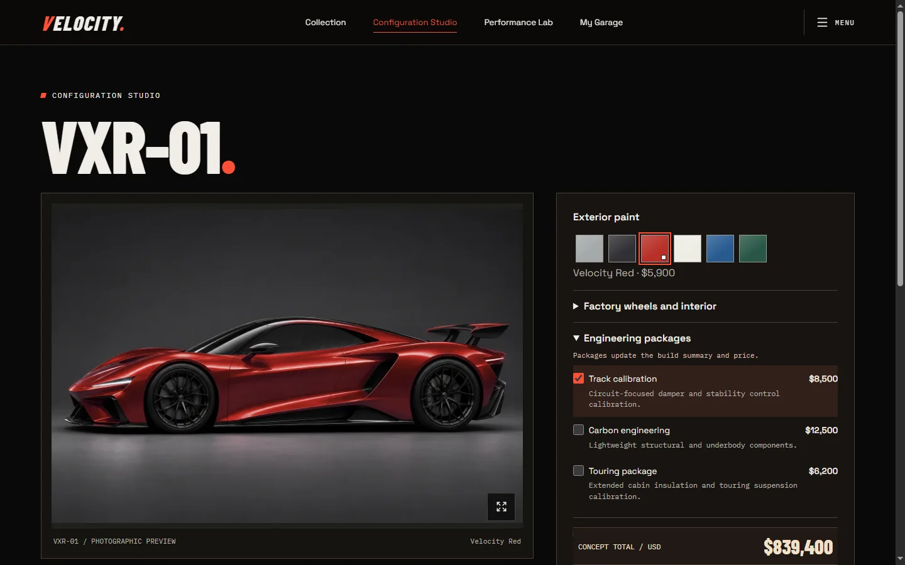

# VELOCITY — Beyond Performance

An independent React portfolio project about the design and engineering of four fictional performance cars. All models, specifications, prices, and sprint simulations are illustrative.

[Live demo](https://vishalsinghbhadoriya.github.io/velocity/) · [Build and deployment workflow](https://github.com/vishalSinghBhadoriya/velocity/actions/workflows/pages.yml) · [Asset credits](ASSETS.md)


## Experience

- Search and filter the collection by model, category, and output, or sort by price. Each detail page includes specifications and image-anchored feature annotations with keyboard dismissal and fullscreen support.
- Preview six VXR-01 paint finishes, select engineering packages, review an itemized total, and export or share a configuration.
- Compare up to three models in the Performance Lab. The acceleration demonstration uses linear interpolation between zero and the published fictional sprint times.
- Save favourites and builds in My Garage. Reopen, rename, duplicate or remove saved builds in the same browser.



[Mobile homepage screenshot](docs/mobile.webp) · [Fullscreen vehicle hotspot screenshot](docs/hotspots.webp)

## Run locally

Requires Node.js 22 and npm.

```sh
npm ci
npm run dev
```

| Command | Purpose |
| --- | --- |
| `npm run dev` | Start the Vite development server |
| `npm run lint` | Run ESLint |
| `npm run typecheck` | Check TypeScript |
| `npm test` | Run the Vitest and React Testing Library suite |
| `npm run build` | Type-check and build the GitHub Pages artifact into `dist` |
| `npm run preview` | Serve the production build locally at `/velocity/` |

## Technology

React, TypeScript, Vite, React Router, Tailwind CSS, Zustand, GSAP and ScrollTrigger, Motion, Lenis, and SVG instrumentation.

## Architecture

| Directory | Responsibility |
| --- | --- |
| `src/app`, `src/layouts` | Router, lazy route boundaries, application shell and navigation |
| `src/pages` | Route-level compositions |
| `src/data` | Typed vehicle catalogue, technical figures and supported options |
| `src/features` | Configurator pricing and URL validation, catalogue search, comparison calculations and feature UI |
| `src/stores` | Zustand state and persisted garage data |
| `src/animations` | Scoped GSAP timelines and ScrollTrigger lifecycles |
| `src/styles` | Tailwind CSS entry point, design tokens and route styles |
| `src/tests` | Vitest and React Testing Library |
| `public/media` | Local WebP campaign and configurator assets |

The garage store persists saved builds, favourites and comparison selections. Drafts are kept in memory during a session. Hydration checks saved model references and normalizes configuration options. The pricing utility validates each option against the model and derives the itemized price and total from the same inputs. Repeated package IDs incur a single charge.

CSS provides directional route reveals. Motion handles paint transitions and collection reordering. GSAP choreographs the campaign entrance, counters and pinned photographic crossfades. The desktop pin and Lenis require a fine pointer and a preference for motion. Touch and reduced-motion layouts present the story in normal document flow. Route splitting, local fonts and responsive WebP assets keep the loading path short.

The vehicle gallery provides fullscreen viewing, a frame counter and captions, drag and swipe gestures, and arrow-key navigation. The Performance Lab draws its gauges and metric bars with SVG and keeps exact values available as text and in the comparison table.

## Vehicle visualization and limitations

The studio uses a fixed-angle photographic render with six locally generated VXR-01 paint variants. Other models use their factory exterior render. Wheels and interiors have a single factory specification. Engineering packages affect the itemized price. The cockpit image on secondary models is identified as a studio design study.

The garage and shareable configuration URLs are client-side. Clearing browser data removes saved builds. Shared URLs encode the options and can be opened in another browser.

The gallery recalculates feature coordinates from the displayed image’s aspect ratio and letterboxing. Feature panels sit beside the vehicle at wider widths and below the image on smaller layouts. The desktop story uses a pinned scroll sequence, while touch and reduced-motion layouts scroll naturally.

## Testing and deployment

Run `npm run lint`, `npm run typecheck`, `npm test`, and `npm run build` before publishing. The tests cover filtering and sorting, package pricing, paint selection, configuration query parsing, persistence, and performance calculations.

- **GitHub Pages** builds and deploys `dist` on pushes to `main`. In the repository’s **Settings → Pages → Build and deployment**, select **GitHub Actions** as the source. The workflow also supports manual runs. The production base is `/velocity/`, and nested shareable URLs use hash routing, for example `/velocity/#/configure/vxr-01`. The hash keeps refreshes on the static entry point.
- **Vercel** uses `npm run build -- --mode vercel`. The included rewrite supports direct visits and refreshes on browser-router paths.

See [ASSETS.md](ASSETS.md) for visual provenance and typography licenses.
